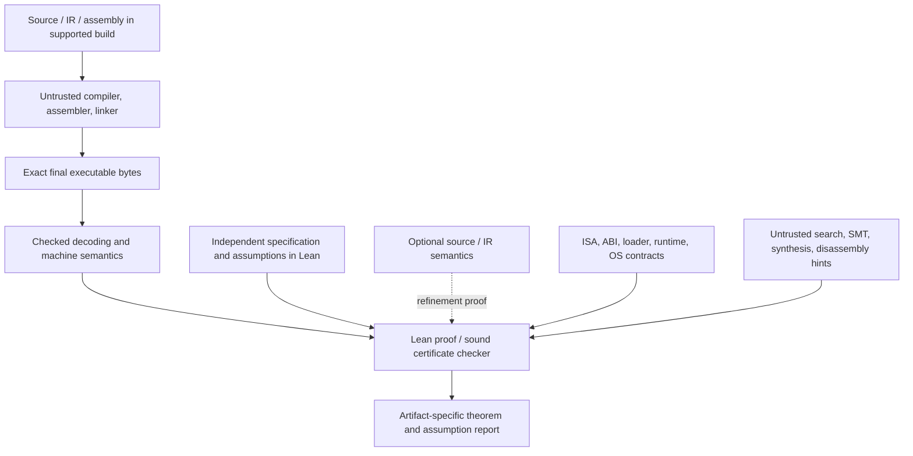

# Lean 4 architecture

Status: architectural plan with an implemented restricted x86-64 function-byte
profile, execution proofs and live compiler certificate path. See
[coverage](coverage.md); the wider OS/source/loader architecture remains planned.

## The proof boundary

Use Lean for typed embedded syntax, semantics, program proofs, certificate
checking, and composition. The host is Lean; GNU C23, GNU C++26, LLVM IR,
assembly, and OS operations are represented domains. Constructing a Lean term
for thread creation does not create a host thread.

The primary route is [direct binary verification](binary-first.md). Compiler
outputs from C, C++, Rust, or other languages share the selected machine-code
semantics. Full frontend semantics are optional for that route and are required
only for claims that also establish source-language preservation.

Keep independently defined specifications and semantics separate from the
program generator and the certificate format. A checker soundness theorem must
connect acceptance to those semantics; defining correctness as acceptance
would leave the central obligation unproved.

For small subsets, proved Lean lowering passes can replace individual
validation steps. All paths must reach the final executable bytes; proving
assembly text alone leaves assembling, relocation, and loading obligations.
See [verification](verification.md) for the theorem and artifact manifest.

## Planned components and dependencies

| Component | Responsibility | Depends on |
| --- | --- | --- |
| Semantic foundations | Traces, outcomes, transitions, infinite executions, refinement, resource identities, observation maps | Lean logic; selected reusable libraries |
| Source domains | Distinct typed GNU C23/C++26 syntax, definedness, evaluation and concurrency semantics | Foundations, language revisions, layout profile |
| LLVM domain | Versioned SSA/IR semantics, poison/UB, calls and atomics | Foundations, LLVM revision, memory model |
| Machine domain | Exact-byte decoding, register/flag/memory transitions and ISA weak memory | ISA specification, bitvectors, decoder soundness |
| OS domain | Resource ownership, syscalls, failures, threads, scheduling, synchronization, I/O | Foundations and explicit native contracts |
| Program logic | Preconditions, invariants, ownership, rely/guarantee and temporal rules | Corresponding operational semantics and soundness proofs |
| Emit/import boundaries | Correspondence for source, IR, object and executable formats | Syntax/decoding semantics, bounded parsing and artifact equality |
| Validation | Certificate syntax, executable checker and soundness, proof reconstruction | Both sides' semantics and well-formedness |
| Composition | Linking, ABI calls, loading, environment and observation correspondence | Component refinements and compatibility proofs |
| Cost reasoning | Work/step/space metrics and restricted optimality theorems | Instrumented semantics; separate cost-preservation proofs |
| Artifact tooling | Reproducible manifests, diagnostics, cache invalidation, proof/assumption reports | Checked definitions and exact dependency identities |

These are logical module boundaries, not a requirement to build a monolithic
universal IR. Share bit widths, layouts, events, ownership vocabulary, and
contracts without conflating C pointers, LLVM pointers, and machine addresses.
Memory and concurrency models need explicit relations between levels.

## Lean engineering decisions

1. Pin the Lean toolchain and every future dependency revision; keep proofs
   reproducible without undocumented local libraries.
2. Start with Lean/Std. Evaluate mathlib for mathematics and Iris-Lean for
   resource reasoning before developing equivalent infrastructure. Pin and
   audit any adopted dependency; no library supplies the whole pipeline.
3. Use inductive syntax with explicit typing/well-formedness evidence. Separate
   proof-relevant models from parsers, printers, external tool runners, and UI.
4. Define partial/unsupported cases explicitly. A total implementation function
   may return an error; absence of a proof is never an implicit success.
5. Treat executable evaluators and checkers as implementations of a separate
   specification. Prove soundness before using acceptance to certify artifacts.
6. Keep proof search and solver integration outside the trust boundary wherever
   results can be reconstructed or checked in Lean. A solver's `unsat` string
   alone is insufficient.
7. Audit theorem dependencies and review hypotheses. The axiom audit cannot
   detect a misleading theorem whose assumptions already contain the desired
   conclusion or whose admitted input domain is empty.
8. Measure elaboration, checker time, proof size, and memory on representative
   examples. Optimize with sound reflection/proof reconstruction rather than
   silently moving execution into an unchecked native trust path.

## OS and platform composition

An OS contract describes the environment transitions visible to a program.
It includes permissions, failure outcomes, partial I/O, resource identity,
thread lifecycle, interference, blocking, and the effects of interruption.
Resource lifetimes connect these operations to source and machine memory.

The first platform is Linux userspace / x86-64 / System V ABI / a restricted
ELF profile. Implement function-byte reasoning first, then static loading and
minimal syscalls. Add stack/heap resources and concurrency only with the
necessary semantics. Contracts for libc/pthreads are assumptions until the
actual relevant implementation is verified against them.

A proof under a Linux contract is not a proof of Linux. A hardware model is not
a physical CPU validation. The [platform plan](platform-model.md) and
[trust ledger](trust.md) keep these boundaries explicit.

The [OS implementation track](os-implementation.md) targets concrete kernel,
runtime, and driver components as machine code. Each checked implementation
theorem can discharge a matching OS contract after a composition proof. Kernel
execution needs a separate privileged-mode profile with interrupts, page tables,
and relevant device behavior. Source or LLVM IR can help construct the proof;
the final implementation claim remains bound to the deployed bytes.

## Interface policy

Each supported operation needs syntax, semantics, ownership/effects, progress
and error behavior, capability requirements, native mappings, and named proof
obligations. Each lowering needs an observation relation, initial-state
relation, environment relation, and termination/divergence policy. Each
certificate checker needs a soundness theorem, rejection behavior, and binding
to the bytes and profile being certified.

Inline assembly, raw IR, foreign calls, and syscalls require explicit effects
and contracts. Unsupported behavior is rejected or reported as an assumption
in a separately labeled conditional theorem; it cannot be hidden by erasing
its observations.
