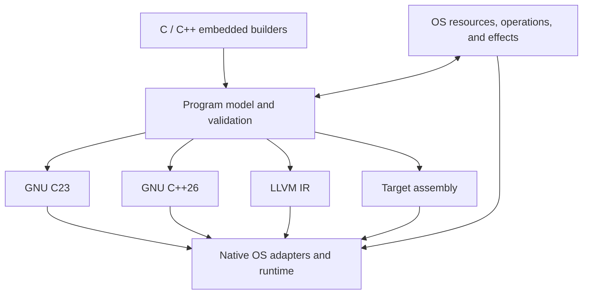

# Architecture proposal

Status: design requirements and proposed direction. No API or IR described
here is implemented or stable.

## Embedding and language domains

The project needs composable embedded representations of GNU C23, GNU C++26,
LLVM IR, target assembly, and OS operations. C and C++ are the implementation
languages. A typed C++ builder is a candidate for the first embedding API; a
C-hosted construction API and its relationship to that builder need an explicit
design decision in the first implementation milestone.

Keep host execution separate from the program being described: creating a
thread node in a builder must not accidentally create a native thread in the
builder process. Generation, validation, compilation, and execution need clear
boundaries.

The language domains are not interchangeable syntax printers. They need
language-specific constructs, source locations, and a common core for values,
types, control flow, resources, and effects. Cross-language boundaries need
declared linkage, calling conventions, data layout, and ownership contracts.

## Proposed composition

This is a proposed set of lowering routes. A backend may invoke an existing
compiler or assembler; the project need not implement every compiler pass.
Assembly can also appear as an explicit target-specific region in a larger
program. OS requirements remain attached to operations until the chosen target
has a defined implementation for them.

## Shared model requirements

- Values and types: width, signedness, alignment, layout, address space, object
  lifetime, pointer provenance assumptions, and target-dependent properties.
- Control flow: functions, blocks, branches, loops, calls, returns, and explicit
  exceptional or error exits where relevant.
- Resources: identity, ownership, borrowing, sharing, creation, transfer,
  destruction, and cleanup after partial failure.
- Effects: memory reads and writes, atomic operations, synchronization,
  blocking, thread/process lifecycle, I/O, allocation, and external calls.
- Target contract: CPU architecture and features, OS, ABI, object format,
  compiler/tool versions, and required runtime/kernel capabilities.
- Diagnostics: identify the originating builder operation and the unsupported
  or invalid contract before producing an executable.

The model must distinguish ordinary shared memory from atomic objects and
device memory. It must also distinguish atomic operations from compound
critical sections, transactions, and process-shared synchronization. These
require different guarantees.

## Semantics across layers

C/C++ language rules, LLVM IR rules, CPU ordering, and OS synchronization each
constrain a lowering. An instruction that is atomic on one CPU is not by itself
a complete C or C++ synchronization contract. Compiler barriers, CPU fences,
and kernel waits need separate representations and documented mappings.

Do not infer synchronization from `volatile`, a syscall, or a generic foreign
call. Calls must carry their known effects or conservatively preserve unknown
effects. Do not strengthen promises about lock freedom, fairness, cancellation,
or progress merely because a backend happens to use a particular instruction.

Raw LLVM IR, inline assembly, and raw syscalls are useful escape hatches. Each
must expose its target restrictions, inputs, outputs, memory effects, clobbers,
and any unchecked assumptions. Unknown effects must prevent invalid reordering.

## OS adapters

Start with Linux/x86-64 and prefer existing native interfaces for the first
correct implementation. Direct syscalls, futex-based primitives, and specialized
assembly should be introduced for a defined semantic or measured performance
need. The runtime can use C and assembly behind a narrow ABI.

A shared vocabulary may cover several operating systems, but platform-specific
features need explicit capability discovery and diagnostics. Missing facilities
must not be emulated with weaker semantics without an explicit caller choice.
Kernel version, libc behavior, permissions, and dynamically unavailable
capabilities may require runtime checks as well as compilation checks.

## References

- [GCC language dialect options](https://gcc.gnu.org/onlinedocs/gcc/C-Dialect-Options.html)
- [LLVM language reference](https://llvm.org/docs/LangRef.html)
- [LLVM atomics guide](https://llvm.org/docs/Atomics.html)
- [Linux userspace API documentation](https://docs.kernel.org/userspace-api/index.html)

The implementation must record the toolchain and platform versions against
which its individual mappings are verified.
