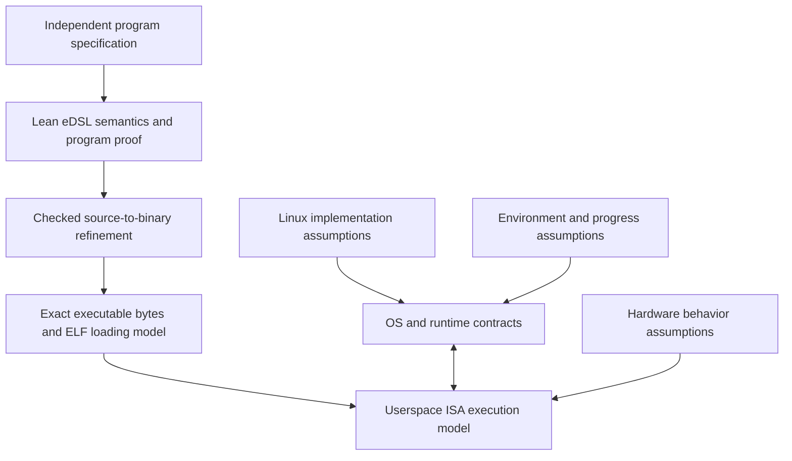

# Platform model and the boundary of the guarantee

Status: proposed specification and verification plan. No Linux implementation,
complete x86 model, ELF loader, runtime, or compiler-output validator is proved
by this document. The first target is a **selected Linux/x86-64 userspace
configuration**, formalized in Lean 4. Coverage must grow through explicit
fragments rather than an implicit claim about every Linux machine.

The default is [direct binary verification](binary-first.md); source-language
preservation is an optional extra. The [OS implementation track](os-implementation.md)
adds a separate privileged-mode target for concrete kernel components. Its
proofs can discharge corresponding userspace OS contracts after composition;
the userspace profile described below alone cannot execute or verify a kernel.

## The intended claim

The useful end result is a theorem about the executable that is actually run:
given a specified initial state and an environment satisfying named contracts,
every permitted execution has the required result or one of the explicitly
specified exceptional outcomes. If termination is claimed, its progress
assumptions must also be satisfied.

There are several different statements on the path to that claim:

| Statement | What must justify it |
| --- | --- |
| The eDSL program satisfies the intended property | A Lean proof over the eDSL's defined semantics; the property is specified independently of the generator |
| This compiler output preserves that property | A verified compiler for the supported fragment, or a sound translation validator for these exact output bytes |
| Those bytes are the loaded program | A checked object/ELF/link/load relation, entry-state conditions, and binding of the checked artifact to the executed artifact |
| Modeled machine execution satisfies the property | An ISA-plus-OS composition theorem covering calls, faults, concurrency, and admitted environment actions |
| The actual Linux machine satisfies the model's assumptions | Initially an explicit external assumption supported by documentation and conformance evidence; stronger implementation refinement proofs would be separate work |

In mathematical shorthand, the target theorem has the shape below. These names
describe obligations, not implemented Lean declarations:

```text
ProgramProperty(source)
  and CheckedTranslation(source, executableBytes, target)
  and ValidInitialState(executableBytes, target, initialState)
  and EnvironmentContract(target, environment)
  imply PropertyOfAllExecutions(executableBytes, initialState, environment)
```

The translation result must quantify over executions, not just compare one
test run or final register value. Refinement permits implementation choices
within the source specification, but cannot introduce undefined behavior,
observable failures, or divergence that the source contract disallows. Extra
conditions are needed to preserve total correctness rather than safety alone.

An external termination event can be modeled as a distinct abort outcome. It
must not permit arbitrary successful output. Report both the result on normal
completion and the safety property before any admitted external abort, so
allowing process termination does not make the theorem vacuous.

## Layers that must compose



An x86 instruction model answers what an instruction means. It does not say
that a pointer names a live C++ object, that a syscall meets its advertised
contract, or that a scheduler runs a thread. Conversely, a syscall contract
does not establish the machine's memory-ordering behavior between syscalls.
The [Intel Software Developer Manuals](https://www.intel.com/content/www/us/en/developer/articles/technical/intel-sdm.html)
cover instruction behavior and system architecture; the
[x86-64 psABI](https://gitlab.com/x86-psABIs/x86-64-ABI) governs application
binary interfaces; the [Linux uAPI documentation](https://docs.kernel.org/userspace-api/index.html)
and per-interface man pages document the OS boundary. Each supplies a different
part of the requirements.

The model must account for interaction: a syscall can read userspace memory,
an interrupt can delay a thread, a signal handler can run on its stack, and a
shared mapping can have another writer. Separately correct models with
incompatible assumptions do not yield a composed theorem.

## Initial target profile and reproducibility manifest

The starting profile is deliberately narrow: x86-64 long mode, little endian,
LP64 System V userspace ABI, Linux ELF, ordinary coherent write-back memory,
integer instructions from an enumerated subset, a single process, and static
linkage for the first platform demonstration. It initially excludes x32/i386
compatibility, SIMD/floating point, JIT/self-modifying code, device memory, and
dynamic symbol loading. Each added feature requires a new supported profile
and corresponding proofs.

A usable proof artifact must contain a machine-readable target manifest with
at least these fields. No particular kernel, libc, or CPU version is claimed
supported until a concrete artifact fills them in and passes its gates.

| Field group | Required information |
| --- | --- |
| Formalization | Lean/toolchain version, package revisions, semantic model revision, theorem identifiers, logical axiom report, proof/validator/checker versions |
| Program and toolchain | Source/eDSL identity, compiler identity and exact options, assembler/linker versions and flags, linker script, selected language dialect and LLVM revision/data layout |
| Executable | Full checked bytes or artifact identity, ELF class/machine/type, loadable segments, entry point, relocations, permissions, startup/runtime objects, required libraries and build IDs if any |
| ISA | Vendor/model/stepping where relevant, enumerated instruction/features used, memory types, atomic alignment/width restrictions, applicable manual revision and errata, microcode/firmware assumptions |
| Kernel | Version/build/configuration identity, syscall ABI, required capabilities, page-size assumptions, relevant security and scheduling policy, runtime feature checks |
| Userspace runtime | libc/pthread/allocator versions and contracts, static/dynamic linkage, loader identity, TLS model, symbol-resolution restrictions, environment-sensitive behavior |
| Process entry | Initial mappings, stack and stack bound, arguments/environment, auxiliary vector entries used, descriptor capabilities, signal dispositions/masks, credentials, resource limits |
| External environment | Other allowed threads/processes and writers, peers, filesystem/storage assumptions, OOM/termination policy, interruption policy, scheduler/progress conditions |
| Substrate and evidence | Bare metal versus VM/emulator/WSL, hypervisor identity/features where applicable, actual execution host, independent checks and their limits |

Version numbers and hashes identify what was checked; they do not prove the
identified implementation correct. If an artifact uses a hash rather than
direct byte equality to bind execution to the proof, state the hash-collision
assumption and the deployment mechanism that prevents replacement after
checking. ASLR should be accommodated by a relocation/representation theorem
or explicitly constrained by the selected profile, rather than silently
relying on one observed address.

## Machine semantics and native boundaries

### Instruction and memory semantics

Implement or adopt an executable decode/execute semantics for the selected
instruction subset, backed by Lean proofs. Register aliases, subword writes,
flags and undefined flag values, addressing modes, canonical addresses,
alignment, fault behavior, endian loads/stores, and control transfers are part
of that subset. Decode failure or an instruction outside the fragment makes
validation fail; it must not become a no-op or an unconstrained successful step.

The decoder/encoder relation must connect bytes to instructions. Reasoning
about assembly text while trusting the assembler leaves a gap. Add a trusted
assembler only as an explicitly named intermediate assurance level, then
remove that assumption by checking the final decoded bytes.

For concurrency, connect the instruction semantics to a memory model such as a
carefully scoped x86-TSO-style model for ordinary memory, including atomic RMW
and fence behavior. A single-step sequential interpreter is insufficient. The
[x86-TSO paper](https://www.cl.cam.ac.uk/~pes20/weakmemory/cacm.pdf) supplies a
rigorous HOL4 model and clear examples of store-buffer behavior. Its scope and
connection to the selected ISA revision require review; copying a few rules
does not transfer its theorems into Lean or cover every memory type.

### Calling conventions and syscalls

Specify System V function arguments/results, caller/callee-saved registers,
stack alignment and red-zone conditions, stack ownership, aggregate layout,
variadic restrictions, TLS, and unwind behavior for the fragment actually used.
Unwinding/exceptions and C++ ABI features stay unsupported until modeled.
Callbacks need entry and exit contracts just as direct calls do.

Specify the Linux syscall ABI separately: syscall number, argument registers,
clobbers, result/error encoding, accessible memory regions, and each supported
call's behavior. On Linux x86-64, syscall arguments use `rdi`, `rsi`, `rdx`,
`r10`, `r8`, and `r9`; this differs from the ordinary function convention.
The libc `syscall()` wrapper also transforms error handling, as documented in
[`syscall(2)`](https://man7.org/linux/man-pages/man2/syscall.2.html). Model
`errno` as thread-local library state where used, rather than attributing its
convention to the raw instruction.

Do not assume a syscall entry or return creates the language synchronization
edges an application needs. For each syscall, justify memory access and
ordering obligations at the user/kernel boundary independently of language
atomics. Model failure, partial effects, interruption, restart, and delayed
completion where that interface permits them.

### ELF, linking, loading, and startup

Check program headers, file/memory ranges, entry point, permissions,
zero-filled storage, relocation resolution, symbol binding, and all executable
startup paths. Prove the loaded image relation for the exact static ELF
fragment before adding general relocation types or dynamic linking. Preserve
ABI conditions through the entry stub and every library boundary. The initial
stack/auxiliary-vector contents a program reads must be specified, and unused
contents may remain nondeterministic.

Later dynamic linking adds dependency selection, search paths, relocations,
symbol interposition/versioning, lazy binding, TLS relocation, IFUNC dispatch,
constructors and destructors, and code loaded after startup. Environment
variables can affect library resolution. The native loader is a substantial
component with its own behavior, documented in
[`ld.so(8)`](https://man7.org/linux/man-pages/man8/ld.so.8.html). Freezing a
library version without controlling which image is selected does not bind a
proof to a run.

### Library and runtime choice

The initial write/exit demonstration may use a tiny raw-syscall startup path
to keep its boundary small. This is a scope choice for that demonstration,
not a commitment to reimplement pthreads or libc. For threads, prefer a pinned
native pthread implementation behind a small project ABI, with the runtime
contract stated as an external assumption until a verified replacement or
binary proof is available. Verify the wrapper's register/layout, lifetime,
error propagation, and cleanup behavior.

`pthread_create` is not merely a raw clone syscall: native runtime behavior
includes thread startup, stack/TLS setup, library bookkeeping, and teardown.
Likewise malloc/free, buffered I/O, and C++ exceptions add contracts beyond the
kernel calls beneath them. Build dependencies determine proof dependencies.
An unknown foreign call must conservatively expose interference or be rejected
by the requested proof profile.

## Trust and claim levels

Maintain a per-theorem assumption ledger. Mark items as **proved in Lean**,
**external theorem with a checked bridge**, **explicit contract assumption**,
or **empirical evidence**. A link to a proof in another prover is not a
checked bridge. Do not promote an assumption into a proved claim merely by
placing it in a Lean structure or typeclass.

| Boundary | Initial status and how it could improve |
| --- | --- |
| Logic and proof checking | Trust the selected Lean kernel and reported foundational axioms; reject project claims using unreported axioms, `sorry`, or a compiler-correctness assumption disguised as a theorem |
| Specification adequacy | Human review and independent examples connect formal properties to intent; a kernel-checked theorem cannot prove that the intended requirement was stated correctly |
| Compiler/assembler/linker | Initially label unverified edges; translation validation or verified passes must cover the emitted artifact before an end-to-end verified claim |
| ABI, wrapper, runtime | Prove project-owned wrappers; explicitly assume any native library contract not covered by the proof; add binary/runtime verification separately |
| Linux implementation | Assume the selected kernel satisfies the used syscall/memory/scheduling contracts; conformance checks can detect disagreement but do not verify the whole kernel |
| Loader/start state | Prove the supported loading relation; assume or separately verify that the actual loader establishes it and that checked images are the images executed |
| CPU and platform | Assume hardware implements the selected architecture/memory model, including relevant errata assumptions; physical faults, firmware behavior and virtualization need explicit scope |
| External world | State permitted peers, resource exhaustion, signals, storage failures, malicious interference and progress assumptions rather than silently fixing a friendly world |

The normal functional-correctness profile may assume no hostile kernel,
debugger/ptrace mutation, unexpected DMA writes, or hardware fault. It should
still state how ordinary errors and admitted termination are observed. Devices
and shared-memory peers require explicit interference models when present.

Interrupts normally enter the kernel rather than become userspace callbacks;
their effects on scheduling, time, and signal delivery still matter. User
signals require handler/mask/frame rules if enabled. Excluding installed
handlers does not disable unmaskable external termination. Cache behavior and
speculation need not appear in a first functional theorem, but their omission
must be explicit for timing, side-channel, or performance claims.

## Existing work: reuse candidates and limits

Evaluate dependencies with a small reproducible experiment, a pinned revision,
a license review, and a theorem-scope/axiom audit before committing to a large
port. Useful primary sources are:

| Work | Useful role | Gap that remains for this project |
| --- | --- | --- |
| [Iris-Lean](https://github.com/leanprover-community/iris-lean) | Existing Lean 4 concurrent separation-logic infrastructure, proof tooling, and HeapLang example | Instantiate for this project's language/OS semantics and prove adequacy/refinement; review its [compatibility differences](https://github.com/leanprover-community/iris-lean/blob/master/docs/compatibility.md); it is not a supplied Linux/x86 verifier |
| [x86isa](https://github.com/acl2/acl2/tree/master/books/projects/x86isa) | Executable x86 fetch/decode/execute model and machine-code proof infrastructure in ACL2 | Audit instruction, system, and concurrency scope; port definitions/proofs or build a checked bridge; no automatic Lean theorem import |
| [x86-TSO](https://www.cl.cam.ac.uk/~pes20/weakmemory/cacm.pdf) | Formal weak-memory model and correspondence ideas in HOL4 | Scoped Lean realization and proof connection to selected instructions, source atomics, and OS interference |
| [Sail](https://github.com/rems-project/sail) and its ISA/tool ecosystem | Architecture-definition and model-generation approach, including concurrency tooling for supported models | Target/backend coverage and trusted-generation story require a specific experiment; do not assume a complete x86-to-Lean stack exists |
| [Reopt VCG](https://github.com/GaloisInc/reopt-vcg) | Reference for binary/LLVM comparison and generated verification conditions | Its documented SMT workflow is not a project proof in the Lean kernel; investigate provenance, semantics, solver trust and current compatibility before reuse |
| [seL4 proofs](https://sel4.systems/Verification/proofs.html) | Example of explicit functional/binary correctness layers for a real kernel | Different OS/API; guarantees vary by [verified configuration](https://docs.sel4.systems/projects/sel4/verified-configurations.html) and retain [documented assumptions](https://sel4.systems/Verification/assumptions.html); no Linux theorem follows |

The Linux-first contract approach and a verified-kernel target are distinct
tracks. A later seL4 backend could reduce kernel trust for the configurations
and properties its proofs cover, but would still need application/runtime,
ABI, ISA, and theorem-composition work. Booting Linux inside a verified
microkernel does not automatically prove Linux's syscalls correct.

## Platform completion gates

1. **Model review:** pin primary specifications; enumerate every supported
   instruction, ELF feature, call, outcome, and assumption. Keep unsupported
   capabilities explicit and fail validation when encountered.
2. **Executable semantics:** run independent instruction and ABI scenarios,
   including faults and negative cases; compare against a native reference or
   independent model. Such comparisons validate the model empirically, not
   mathematically against physical silicon.
3. **Checked composition:** prove representation, decode, loading, call-boundary,
   and source/binary refinement lemmas. A toy evaluator theorem counts only as
   a toy evaluator theorem until all required platform edges exist.
4. **Artifact certificate:** emit the manifest, exact program identity,
   specification/theorem identities, checked proof result, assumption ledger,
   and rejected/unsupported features. Successful compilation and a zero exit
   status alone cannot stand in for this certificate.
5. **Reproduction and deployment:** rebuild/check in a clean pinned environment,
   run the exact bound artifact through the declared entry path, and record
   observed platform facts. Changed bytes, tool flags, library resolution, or
   unsupported CPU/kernel features invalidate the certificate until rechecked.

For minimum-operation claims, count an explicitly defined event or instruction
in this composed model. Userspace instructions, kernel instructions, scheduler
steps, abstract DSL operations, and CPU micro-operations are different metrics.
An external syscall contract does not reveal or bound the kernel's internal
instruction count. Scheduling delays and interruptions make wall-clock cost a
separate theorem. The optimization plan must name the admitted program class,
ISA fragment, inputs, observations, and cost metric before any lower-bound or
optimality claim is meaningful.
