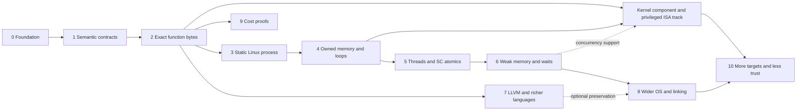

# Roadmap and acceptance gates

This is a research and engineering plan, not a claim that complete GNU C23,
GNU C++26, LLVM, x86-64, or Linux semantics already exist in Lean. Work is
ordered by proof dependencies. There are no completion-date promises.

## Decisions for the initial direction

- Lean 4 is the implementation/proof/embedding language.
- OS behavior is a first-class semantic domain across every language layer.
- Existing compilers are untrusted producers. Direct binary verification is the
  main path; source/IR translation validation adds an optional stronger guarantee.
- Start with x86-64 userspace and a restricted Linux/System V/ELF profile.
- Begin with a small function before process loading, memory and concurrency.
- Report physical-platform and OS conformance assumptions explicitly.
- Use explicit cost models and restricted candidate classes for lower bounds.
- Apache-2.0 plus NOTICE/citation metadata; DCO 1.1 for contributions.
- Publish code and owned fixtures, with real findings/evidence kept out of Git
  and CI artifacts. Validate concrete OS components to discharge contracts.

## Dependency graph

### 0. Foundation — current repository

Present: pinned Lean/Lake project; generic refinement composition and safety
transfer; a tiny abstract-machine correctness/lower-bound example; transitive
axiom audit; optional native dialect checks; design documents; licensing and
contribution policy. CI must build/audit Lean and retain native probes as a
separate check. The first concrete function-byte profile is now implemented;
see [coverage](coverage.md) for exact theorems, supported instructions and trust.

### 1. Semantic contracts and reuse decisions

Define trace/outcome types, admitted initial states, divergence/fault/deadlock
policy, environment coupling, memory/resource identities, observations and
refinement. Prove composition, nonvacuity obligations and suitable safety/
termination transfer lemmas. Decide operational versus event-graph concurrency
representations and their correspondence.

Evaluate reusable Lean bitvector, SSA, temporal and resource-logic libraries;
record revisions, licenses, supported Lean versions, axiom dependencies,
performance and gaps. Establish a per-feature support/proof ledger.

Exit: reviewed theorem templates and an executable toy semantics whose proofs
exercise the interfaces; no circular correctness-by-checker-definition.

Implemented so far: deterministic x86 execution closure, evaluator soundness/
completeness, result determinism and divergence exclusion. Shared-memory
nondeterminism, OS traces and temporal composition remain future work.

### 2. First real artifact: a restricted function

The first increment contract is implemented for `8d 47 01 c3`, with live
Clang C/C++ and GCC C certificates and native boundary checks. Full scope and
remaining artifact/physical-conformance assumptions are in [coverage](coverage.md).
The memory extension also checks `8b 07 c3` (32-bit load) and `89 37 c3`
(32-bit store), each from Clang C/C++ and GCC C. Permission, little-endian value,
outside-footprint framing, preserved code/return stack and two-step termination
are proved. General instruction sequences and control flow remain next extensions.

Choose a loop-free unsigned fixed-width function specification with edge cases.
Select a small x86-64 instruction subset, prove exact-byte decoding and
instruction semantics, and state entry/return/register/stack assumptions.
Compile ordinary source in any available language or supply assembly. A formal
frontend is not needed to prove the resulting binary meets the independent
function specification. Use source/IR annotations as untrusted proof hints.

Invoke a pinned compiler/configuration, ingest its exact function bytes, and
produce a checked proof/certificate relating those bytes to the specification.
Handle all admitted inputs, including wraparound. Initially reject general memory,
foreign calls, exceptions, unsupported instructions and unknown control flow.

Exit: a named Lean theorem for actual compiler output, with recorded build and
caller/platform assumptions; changed immediate values, wrong widths, unsupported
bytes, and mismatched manifests fail validation. Prefer a second compiler or
optimization configuration to expose compiler-specific assumptions.

### 3. Static process and minimal Linux contract

Implemented supporting OS contract: byte-granular mapping/protection/unmapping
with permission-revocation and disjoint-framing proofs. A protection change
outside a binary load's footprint preserves its contract, with a concrete
admitted-entry witness. Independent Linux VM probes cover zero filling, denied
access and adjacent-page preservation. Page-granular syscall refinement and the
process/ELF obligations below remain unimplemented; see [scope](address-space.md).

Model a restricted static ELF, segment/entry validation, startup stack/auxiliary
state, final-byte identity, minimal syscall ABI and termination. Add a tiny
process with bounded computation and explicit `write`/exit outcomes. Specify
short writes, interruption, faults and denied resources rather than assuming
all external effects succeed. Keep loader/kernel behavior conditional.

Exit: a process-level trace/result theorem linked to the final artifact, with
all reachable code/runtime and external contracts accounted for.

### 4. Owned memory, calls and loops

Implemented foundation: sequential four-byte ordinary-RAM reads/writes, explicit
per-byte mappedness/write permissions, read-after-write, disjoint framing and
nonvacuous compiler-profile witnesses. This is not yet object ownership, an
allocator, concurrent atomicity, calls beyond the modeled return, or loop support.

Add object lifetimes, permissions, stack/heap regions, layout/alignment,
provenance relations, allocation/mapping failures and cleanup. Prove supported
calls/returns and loop invariants/variants. Introduce reusable ownership rules
only with their soundness connection to the operational semantics.

Exit: a buffer/loop binary has target memory safety, functional correctness and
explicit termination/resource bounds. Add source definedness/preservation only
when claiming a source-level result. Native fault
injection and differential runs supplement these proofs.

### 5. First concurrency slice

Specify real thread start/join, argument publication, ownership transfer,
creation failure and partial cleanup. Use sequentially consistent atomics first,
with a proved mapping to the chosen machine model. If libc/pthreads is used,
validate its relevant bytes or expose its contract as a remaining assumption.

Workload: shared state, workers performing independently counted increments,
joins, final count and safe reclamation, with failure paths. Prove safety across
all admitted schedules and state additional progress assumptions separately.

Exit: named counter/lifecycle theorems through the full modeled chain; no claim
that testing or SC-only interleavings establishes weak-memory correctness.

### 6. Weak memory, locks, blocking and interference

Add acquire/release and relaxed atomics, compare/exchange, fences, target memory
ordering, publication, mutexes, condition variables and wait/wake. Specify
spurious wakeups, lost-wakeup prevention, interruption, timeouts, cancellation,
process sharing and fairness requirements. Extend signal and scheduling models
where these primitives require them.

Exit: independently specified publication and blocking protocols have appropriate
all-execution proofs/model correspondence, with rejected invalid memory orders
and unsupported guarantees. Safety and liveness claims remain distinct.

### 7. Optional LLVM/source guarantees and richer proof hints

Pin LLVM semantics and implement supported SSA, memory, UB/poison and atomic
constructs. Prove/check source→LLVM, LLVM→LLVM and LLVM→machine relations
separately when those preservation claims are requested. Direct machine-code
proofs remain usable without these layers. Add corresponding machine semantics
and certificates for loops, calls, transformed control flow and vectorization.

Grow GNU C23 and GNU C++26 feature ledgers incrementally. C++ elaboration,
classes, exceptions, templates, standard libraries, modules and coroutines are
separate obligations. General source import needs parsing/elaboration evidence;
a Clang AST dump alone cannot establish source correspondence.

Exit per feature: represented, modeled, executable, proven and artifact-validated
statuses are recorded independently, including exact unsupported cases.

### 8. Program-wide OS behavior and composition

Add processes/signals/IPC, filesystem/durability, networking, async I/O,
time/deadlines, environment/permissions and devices as demanded by workloads.
Extend mapping, TLS, dynamic linking, shared libraries, relocation and loading
only with explicit dependency closure. Model external peers and failures.

Exit per facility: operation contract, native mapping, resource/progress rules,
ABI/link/load obligations, proof evidence and runtime conformance evidence.
No automatic claim of complete POSIX or Linux verification.

### 9. Cost, complexity and restricted optimality

This can proceed from milestone 2 without waiting for all OS coverage. Define
instrumented semantics and counts, prove target bounds, then restricted lower
bounds and certified synthesis/search coverage. Separate work, span, memory,
instructions and elapsed time. Do not claim global optimality from a bounded
search or hardware timing from an ISA step count.

Exit: at least one useful validated function has a target cost theorem; an
optimality claim also quantifies over a specified candidate class and includes
an attaining witness. See [cost model](cost-model.md).

### 10. More targets, automation and trust reduction

Add architectures/OS adapters only with explicit models and capability tables.
Verify concrete runtime/library implementations, improve proof certificates and
checkers, and investigate a verified-kernel platform as a separate route.
In parallel, [ingest concrete OS builds](os-implementation.md) and prove selected
kernel/runtime/driver components implement their contracts at machine level.
Compose those proofs to remove specific OS assumptions. Record checked failures
in the [private findings workflow](findings.md), with no promotion of timeout or
unsupported analysis into a vulnerability claim.
Do not transplant a seL4 theorem onto Linux. Address JIT/self-modifying code,
security/noninterference and detailed time only as separately scoped projects.

Exit per extension: proof composition and trust ledger identify exactly which
assumptions were discharged and which new ones were introduced.

## Workstreams and parallelism

Independent specialists can work on semantic foundations, source languages,
LLVM, ISA/decoding, ELF/ABI/loading, OS/resources, concurrency, validators,
costs, and proof/build tooling. Each owns bounded modules and proof obligations;
interface reviews precede integration. More workers do not remove dependencies
or establish the adequacy of a model by consensus.

Run parallel research and prototype spikes before library choices; pair each
implementation with an independent semantics/proof review. Scale later workers
across feature/target matrices only after the core interfaces are stable. Keep
one integrator responsible for cross-layer observations, assumptions and proof
composition, so individually proved components describe the same execution.

## Risks and decision gates

| Risk | Required response |
| --- | --- |
| Incomplete/changing C++/GNU/LLVM semantics | Versioned restricted subsets; feature-level scope and rejection |
| Pointer/memory mismatch across layers | Explicit object/address/provenance relations before optimization proofs |
| Weak-memory or scheduler assumptions hidden | Cross-layer event model; separate safety/progress and declared fairness |
| Final binary differs from modeled assembly | Exact-byte decoding and link/load validation |
| OS/kernel/library contract is mistaken | Contract review, primary specifications, conformance evidence and visible assumptions |
| Proof search does not scale | Small slices, compositional invariants, checked certificates and profiling |
| Vacuous theorem or unsupported input accepted | Nonemptiness witnesses, independent specifications, adversarial certificates |
| Reuse project incompatible or outside scope | Bounded evaluation with a written adopt/port/rebuild decision |
| Lower-bound claim changes with instruction set | Fix the candidate/cost model and reprove after capability changes |

## Completion reports

Each milestone report must list named theorems and their hypotheses, exact
supported constructs and platform profile, artifact bindings, remaining trusted
components, reproducible commands and meaningful negative checks. Tests check
independent behavior and plausible regressions; they do not substitute for
proofs or repeat the implementation as expected results.
