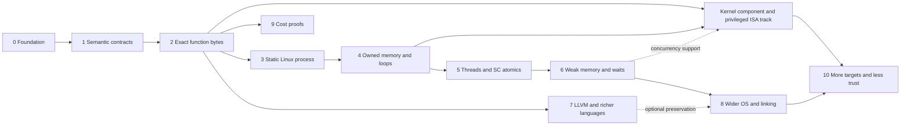

# Roadmap and acceptance gates

This is a research and engineering plan, not a claim that complete GNU C23,
GNU C++26, LLVM, x86-64, or Linux semantics already exist in Lean. Work is
ordered by proof dependencies. There are no completion-date promises.

## Decisions for the initial direction

- Lean 4 is the implementation/proof/embedding language.
- OS behavior is a first-class semantic domain across every language layer.
- Existing compilers are untrusted producers. Direct binary verification is the
  main path; source/IR translation validation adds an optional stronger guarantee.
- Start with x86-64 userspace and a restricted Linux/System V/ELF profile.
- Begin with a small function before process loading, memory and concurrency.
- Report physical-platform and OS conformance assumptions explicitly.
- Use explicit cost models and restricted candidate classes for lower bounds.
- Apache-2.0 plus NOTICE/citation metadata; DCO 1.1 for contributions.
- Publish code and owned fixtures, with real findings/evidence kept out of Git
  and CI artifacts. Validate concrete OS components to discharge contracts.

## Dependency graph

### 0. Foundation — current repository

Present: pinned Lean/Lake project; generic refinement composition and safety
transfer; a tiny abstract-machine correctness/lower-bound example; transitive
axiom audit; optional native dialect checks; design documents; licensing and
contribution policy. CI must build/audit Lean and retain native probes as a
separate check. The first concrete function-byte profile is now implemented;
see [coverage](coverage.md) for exact theorems, supported instructions and trust.

### 1. Semantic contracts and reuse decisions

Define trace/outcome types, admitted initial states, divergence/fault/deadlock
policy, environment coupling, memory/resource identities, observations and
refinement. Prove composition, nonvacuity obligations and suitable safety/
termination transfer lemmas. Decide operational versus event-graph concurrency
representations and their correspondence.

Evaluate reusable Lean bitvector, SSA, temporal and resource-logic libraries;
record revisions, licenses, supported Lean versions, axiom dependencies,
performance and gaps. Establish a per-feature support/proof ledger.

Exit: reviewed theorem templates and an executable toy semantics whose proofs
exercise the interfaces; no circular correctness-by-checker-definition.

Implemented so far: deterministic x86 function and first-syscall execution
closures, evaluator soundness/completeness, result determinism and user-divergence
exclusion. The raw exit contract adds infinite OS observation traces, an
all-completed-results theorem, explicit conditional progress, an indefinite-wait
counterexample and a nonempty fair trace. General temporal composition and
shared-memory nondeterminism remain future work.
The separate sequential execution layer now also handles undefined AF choices,
constructive all-choice total correctness, actual operand-read traces and
reachable-prefix fault/divergence exclusion for the checked sum32 loops.
It also decodes ordinary low8 MOV32 register/load/store forms over full 64-bit
base/SIB addresses and REX.W MOV64 register copies across all 16 GPRs.
Register XCHG64 now supports ModRM and short RAX encodings across all 16 GPRs,
with simultaneous pre-state value flow, complete flags/RAM frames and current
OS composition. Native observations cover all ModRM pairs and ignored prefix
bits; changed RSP retains the original loan without proving a RET binding.
The current owner-resource bridge derives actual two- and
three-byte stores and target loads, retaining the same OS history and loan
frames. Full-pointer copy/store/RET composition retains the same current RAM
coupling and uses the actual original stack binding. MOV64 memory now uses
checked eight-byte primitives and REX.R/B/X base/SIB fields. Single-allocation owner
authority, read-only borrowing and actual checked mutation histories compose
store/load/RET in the same evolved OS world; the 32-bit task policies reject
wide stores rather than treating them as read-only. Exact GNU23/GNU++26 output
has direct raw/ELF certificates. [Eight-byte memory scope](memory64.md) and
[encoding, aliasing and resource scope](sequential-moves.md) remain
explicit; the concurrent backends retain their original instruction subset.
LEA64 and register ADD64 now extend this sequential ISA with pre-state
aliasing, full64 results and current-world resource frames. LEA is pure
address arithmetic; register ADD defines the six arithmetic flags. These
operations support separate fresh GCC/Clang direct-add client proofs with
complete independent result/resource contracts, exact constant instruction
counts and returned authority. The same registered task accepts these clients
without constraining source structure or intermediate store counts. See
[direct-add scope](counted-store-direct64.md).
See [arithmetic scope](sequential-arithmetic64.md).
Full64 register AND/OR/XOR now include both opcode directions, all 16 GPRs,
undefined-AF choices and current-world resource preservation. Independent
native contracts check complete register snapshots and defined flags, then
replay actual captured AF witnesses through Lean; see
[logical operations](sequential-logical64.md). This instruction foundation
does not itself certify whole compiler outputs or source/IR preservation.
Register-only CMOV64 now supplies all sixteen conditions, mathematical
signed/unsigned CMP adequacy and same-world pure-call resource composition.
Six final GCC/Clang comparison clients and three independent scalar comparison
tasks now compose that foundation with current code/caller-slot resources and
raw/ELF proof grading. See [comparison scope](comparison64.md).
The full64 array maximum task extends this with independent current array
loans, empty-input admission and compatible read-only aliases. Complete GCC13
and Clang18 loop clients prove the same unsigned result and full frame;
exact instruction/read accounting stays separate from registration. See
[array maximum scope](array-maximum64.md).
Memory-source ADD64 now has complete qword/flag/frame and current-loan
contracts. Complete 22-byte GCC and 25-byte Clang array-sum clients prove an
independent natural sum modulo 2^64, with all-AF termination, current-resource
prefix policies, raw/ELF proof grading and separate exact accounting. See
[array sum scope](array-sum64.md).
Memory CMOV remains future work; see [conditional move scope](sequential-cmov64.md).
All sixteen unprefixed short Jcc conditions now share the existing condition
semantics, signed-rel8 execution, dynamic/static CFG edge proofs and same-world
code/caller-slot resource composition. JE and legacy JNZ keep their decoder
identities. Near/prefixed forms and additional compiler-loop contracts remain
future work; see [short-branch scope](sequential-short-jcc.md).
The direct StoreReturn32 certificate API now proves both selected compiler
store/copy orderings and a copied-RAX variant against a stronger full-pointer
return post, with checked OS evolution and exact accounting. The distinct
`storeReturn32` grading task also accepts a fresh four-instruction RCX proof,
using the same domains/policies without a shape or accounting admission gate.
It also accepts an independent three-instruction client proof for actual GCC13
`-Oz` exchange/store/RET output, retaining that same checked current-resource return.
Broader pointer contracts and instruction/control-flow inference remain future work.
Separate pointer-store accounting now derives a three-instruction lower bound
from actual executions and the existing ordinary-store policy on useful inputs
requiring a changed RAX. Direct shapes attain it with their current OS return;
the independent grader still accepts slower proved implementations.
The distinct `storeReturnValue64` task now fixes full64 stored/returned values,
eight-byte/ABI/current-resource frames and nonarithmetic flags. Its span policy
keeps actual32/64 checked mutations and current target/loan read authority.
Independent mixed-store and upper-half-read clients demonstrate different
instruction counts and read footprints without changing the domain or limits.
Useful witnesses cover every nonempty admitted candidate, unsupported bytes
and upper-half-only changes. See [full64 result grading](store-return-value64.md).
Reusable cutpoint composition now derives those guarantees from local actual
machine steps: static depth decreases inside a segment, and a natural rank
decreases at cutpoint transfers. Independent contracts and entry admission
remain required; general invariant inference and broader task grading remain open.

### 2. First real artifact: a restricted function

The first increment contract is implemented for `8d 47 01 c3`, with live
Clang C/C++ and GCC C certificates and native boundary checks. Full scope and
remaining artifact/physical-conformance assumptions are in [coverage](coverage.md).
The memory extension also checks `8b 07 c3` (32-bit load) and `89 37 c3`
(32-bit store), each from Clang C/C++ and GCC C. Permission, little-endian value,
outside-footprint framing, preserved code/return stack and two-step termination
are proved. The counted assembly increment loop now has all-count correctness,
termination and exact cost through a backward branch. The ordinary sum32
milestone below adds two structurally checked compiler-produced loop shapes.
The reusable CFG layer now supports local proofs beyond those shape recognizers;
general invariant inference remains ahead.

Choose a loop-free unsigned fixed-width function specification with edge cases.
Select a small x86-64 instruction subset, prove exact-byte decoding and
instruction semantics, and state entry/return/register/stack assumptions.
Compile ordinary source in any available language or supply assembly. A formal
frontend is not needed to prove the resulting binary meets the independent
function specification. Use source/IR annotations as untrusted proof hints.

Invoke a pinned compiler/configuration, ingest its exact function bytes, and
produce a checked proof/certificate relating those bytes to the specification.
Handle all admitted inputs, including wraparound. Initially reject general memory,
foreign calls, exceptions, unsupported instructions and unknown control flow.

Exit: a named Lean theorem for actual compiler output, with recorded build and
caller/platform assumptions; changed immediate values, wrong widths, unsupported
bytes, and mismatched manifests fail validation. Prefer a second compiler or
optimization configuration to expose compiler-specific assumptions.

### 3. Static process and minimal Linux contract

Implemented supporting OS contract: byte-granular mapping/protection/unmapping
with permission-revocation and disjoint-framing proofs. A protection change
outside a binary load's footprint preserves its contract, with a concrete
admitted-entry witness. Independent Linux VM probes cover zero filling, denied
access and adjacent-page preservation. Page-granular VM syscall refinement and
general startup-data obligations remain unimplemented; see [scope](address-space.md).

The restricted ELF container step is now implemented: bounded ELF64LE parsing,
validated load segments and page freshness, exact file-byte/BSS installation,
preservation of existing cells and entry `CodeAt` derivation. Full observed files
are embedded in generated Lean certificates, with compiler profiles checked
through the modeled loader. The function profiles retain explicit caller
stack/data conditions. See [ELF scope](elf.md).

The first standalone process result is implemented: a checked static ELF entry
executes `mov edi,42; mov eax,60; syscall` in exactly three user instructions,
for every modeled initial register/flags state, without caller stack contents,
startup data or runtime. `edsl-certify-process` generates the full-file Lean
certificate. The modeled single-thread, unintercepted raw exit60 contract gives
status42 on every completed trace and eventual completion under explicit
abstract completion progress. Indefinite waiting is admitted without that
assumption, and a terminating fair trace witnesses nonvacuity. Owned Clang/GCC
assembly ELFs receive certificates and native status checks; wrong status and
syscall mutations are rejected. See [process scope](process-exit.md).

The bounded stream-write extension is also implemented: exact message bytes are
bound through the loaded ELF, raw results include partial counts and negative
errors, and every admitted return resumes at checked exit instructions. Completed
user executions cost eight instructions and accept a message prefix; full output
is conditional on a full transfer. Native owned pipe checks exercise successful
output and unavailable nonblocking capacity. Stable stream/return contracts remain
explicit; see [write scope](process-write.md).

Remaining work: Linux loader conformance, startup stack/auxiliary state when
used, privileged syscall entry and concrete kernel execution/cleanup. Extend
the process profile to control flow, retry protocols and resource lifetimes.
Add descriptor identity, signals/interruption and wider I/O without assuming
all external effects succeed. Preserve explicit loader/kernel
contracts until implementation proofs discharge them.

Exit: a process-level trace/result theorem linked to the final artifact, with
all reachable code/runtime and external contracts accounted for.

### 4. Owned memory, calls and loops

Implemented foundation: sequential four-byte ordinary-RAM reads/writes, explicit
per-byte mappedness/write permissions, read-after-write, disjoint framing and
nonvacuous compiler-profile witnesses. Language-object provenance, a runtime
allocator and concurrent atomicity remain ahead. An additive direct-call slice
now covers four whole GCC/Clang nested-call outputs with current OS-owned stack
frames, actual RAM-derived internal/original RET, independent full64 results,
ABI/memory framing and exact five/seven-instruction counts. Checked CPU/OS
histories retain dirty private bytes and reusable current resources. Broader
interprocedural automation and concurrent call profiles remain ahead; see
[owned nested calls](call-stack.md).

A separate [call-stack grader](call-stack-grading.md) now accepts fresh proofs
against a fixed entry-aware resource contract for arbitrary admitted byte
windows. It requires actual covered CPU/OS execution and the independent full64
result, with useful admissions for unsupported code as well. All four nested
compiler clients and a different inlined LEA/RET witness pass raw/full-ELF proof
grading at unchanged default limits. Whole ELF windows include preceding
helpers; the checked final wrapper binds the literal file, span and entry.
The existing Sequential task propositions remain unchanged. Generic task
registration and general interprocedural proof automation remain future work.
A sibling [callable DATA8 library](call-memory64.md) now checks private-stack
and ordinary target mutations in one evolving borrowing world. Generic
stack-contract transport retains both capabilities through mixed writes,
with a union RAM frame. Reachable allocation/initialization, actual covered
GCC/Clang helper-store/reload executions and the independent target/result
contract are proved. A separate [callable DATA8 grader](call-memory64-grading.md)
now accepts fresh nested and inlined proofs against the same independent
contract, binding literal raw/ELF files and entry metadata at existing budgets.
Existing fixed grader tasks stay unchanged; unified task registration,
concurrent calls and broader DATA effects remain ahead.

The [counted-helper milestone](call-memory-loop64.md) now has universal proofs
for complete separate-unit GCC 45-byte and Clang 52-byte texts. They construct
actual covered mixed executions for arbitrary current admitted resources,
all full64 values/counts including zero and maximum, arbitrary old DATA and
every AF stream. The independent result is `RAX=x+n mod 2^64`; DATA retains its
actual old word at zero and holds `x+n-1 mod 2^64` otherwise. ABI, original RET,
RSP+8, exact metadata/permissions and RAM outside the provided private/DATA
union are retained with both current capabilities. The 32-byte present capacity
requirement covers three saved/padding words and the CALL word at S-32.

Checked capacity allocation and initialization preserve old loans, and generic
saved-word transport proves stability under whole-qword-disjoint private
writes and separated DATA writes. A mixed cutpoint certificate is implemented
and checked with the existing inline client; the new compiler clients use
covered histories and direct remaining-count induction. Distinct closed-form
GCC 17-byte and Clang 19-byte clients prove the same all-input root claim, with
entry 0 and no helper. Their final-output/resource contract retains the 32-byte
private admission without requiring a loop or intermediate DATA writes.

The standalone [counted DATA8 grader](call-memory-loop64-grading.md) binds the
unchanged claim to successful pure selection of a complete literal raw/ELF
file, span and entry. Shared selector formats, older task propositions and
budgets stay unchanged; matching driver/exporter imports extend the generic
foundation without trusting compiler clients. CALL, reload, count restrictions
and instruction costs remain outside acceptance. The default gate requires
fresh extraction, bounded nested native observations, source/provenance
snapshots, dependency audits, fresh kernel replay, both nested raw/ELF pairs
and both freshly compiled closed-form raw/ELF pairs at default grading limits,
negative/isolation checks and source/input/installation stability. Explicit
`--native-only` leaves formal and grading phases `NOTRUN`; no closed-form native
observations are claimed. Callable admission remains a caller obligation,
without ELF startup, other-segment or whole-process safety. Source/IR
preservation, physical CPU/kernel refinement, concurrency, atomics, syscalls,
recursion, indirect calls and general interprocedural inference remain ahead.

The counted-loop extension now proves modular increment for every 64-bit count
with a decreasing natural variant and exact `2*count+3` cost, preserving flags
and memory. Raw/full-ELF certificates cover the owned assembly from Clang/GCC;
this is not a compiler source-loop preservation theorem. See [control flow](control-flow.md).

The ordinary [sum32 loop gate](sum32.md) is checked for GCC 13 pointer/count
(`-Os -fno-ivopts`, 19 bytes) and Clang 18 indexed (`-Oz`, 18 bytes) C outputs.
Both meet the same independent natural list-sum modulo 2^32 contract.
`Sum32.sound` constructs actual termination for every undefined-AF stream and
proves full RAX zero extension, full memory/register/return framing,
nonarithmetic-flag preservation and exact four-byte-element/stack8 reads.
Inputs retain full 64-bit count and nonwrapping current spans; empty input
requires no input loan, readability or canonical pointer.

A reusable decoded-CFG checker validates the two restricted shapes within
64 bytes/32 static instructions, including zeroing-prologue variations and
commuted pointer/count updates. Static decode and branch-link proofs bind
actual `CodeAt` memory. Current code/complete-stack/nonempty-input loans and
full current OS RAM couple to the same semantic theorem. Raw/full-ELF semantic
certificate generation retains explicit current caller/resource premises and
uses an ELF entry as a callable function. Owned native ABI/guard-page
observations remain external conformance evidence. This completes the
restricted ordinary read-loop result, while general program grading, source/IR
preservation, broader loops/calls and native runtime/kernel refinement remain
unfinished. The new sequential ISA is outside the existing deterministic/TSO
decoders.

The [reusable CFG gate](cfg.md) now checks complete explicit windows within
64 bytes/32 instructions and composes sparse-cutpoint local VCs into actual
all-choice execution, safety and termination. Static discovery and the
raw/explicit-span ELF importer are separate from functional certification.
The stride-two instance proves all-choice total correctness, exact cost and
ordered reads against an independent even-index sum, with current OS
input/stack/code authority. The [35-byte two-loop GCC instance](pair32.md) now
proves an independent two-list sum, exact cost/read trace and retained current
admissions for both inputs, including compatible aliases and empty phases.
Next bind a fixed task specification, admissible input domain and required
theorem type for objective grading. The separate mixed DATA8/private-stack
cutpoint API supports local actual-step proofs; extending the read-only CFG
importer or grading broader writable/concurrent effects still needs explicit
effect obligations.

The OS/machine memory bridge now proves that checked word stores update natural-
address OS cells exactly as the machine store updates projected memory. Actual
compiler store bytes implement that OS update for all admitted values, retaining
permissions and outside-footprint cells. Physical backing and aliases remain
future obligations.

The sequential ownership registry is now implemented over `AddressSpace.Space`.
Fresh IDs distinguish lifetimes at remapped addresses; transfer epochs revoke
previous authority even across A→B→A or self-transfer. Checked whole-allocation
allocate/adopt/transfer/release/protect and owned word stores preserve the live
registry invariant. Revocation persists through every later managed history.
The owned-store theorem composes with exact machine bytes and has admitted
states for every old word/source argument. Regressions cover reuse, transfer,
cross-allocation stores, hidden cells, final-byte overlap and exact readback.
See [ownership contracts and limits](ownership.md).

Shared read borrowing is now implemented over that registry. Each stored loan
names a current lender ticket and readable contained subregion; multiple loans
freeze their whole allocation until all finish. Checked histories preserve
loan records, exact cells and permissions, and finished IDs stay revoked.
Authorized word reads compose with actual load/RET bytes; arbitrary-history
read and independent buffer stability have checked proofs. Every 32-bit value
has an admitted symbolic binary witness. See [borrowing scope](borrowing.md).

These remain proof-level authorities: raw pointers contain no epoch, principal
IDs are proof data and copyable tickets/loans do not form a linear-token logic.
The [managed read-worker slice](threads.md) now connects borrowed code/data/stack
to actual instruction scheduling and checked start/completion/join contracts.
The [atomic-worker layer](atomic-workers.md) now adds mutable exchange workers
with private old results and retained atomic handles/code/stack loans through
join. A separate mutex profile below now adds protected payload invariants;
concrete thread/runtime refinement remains ahead.
Region splitting, mutable borrowing, broader
stack/heap object lifetimes, language provenance, allocator search/failure/cleanup,
general calls and richer memory-loop invariants remain required. Concurrent
safety needs an interference model that enforces or accounts for resource
transitions.

Exit: a buffer/loop binary has target memory safety, functional correctness and
explicit termination/resource bounds. Add source definedness/preservation only
when claiming a source-level result. Native fault
injection and differential runs supplement these proofs.

### 5. First concurrency slice

Implemented prerequisite: a root-managed read-worker lifecycle with three
internal loans, actual load/RET instruction scheduling against current shared
memory, checked result collection and permanent thread/loan-ID revocation.
All six two-worker instruction interleavings have independent byte/result
regressions; symbolic witnesses cover every 32-bit word. Arbitrary admitted
histories preserve results, and successful schedules with two selections of a
load-pending worker complete it. Idle scheduling need not make progress. This
abstract read-only profile does **not** satisfy the counter workload or concrete
OS/runtime refinement exit below. See [thread contracts](threads.md).

Implemented atomic prerequisite: the `exchange32` profile certifies exact
`MOV EAX,ESI; XCHG DWORD PTR [RDI],EAX; RET` bytes from Clang/GCC in three
instructions with a singleton indivisible RMW-event trace. Guarded OS exchanges
project the same current-cell update while excluding live read loans, and
arbitrary finite same-cell exchange histories prove old/new value chaining.
Native eight-thread token conservation supplements those model proofs;
see [atomic-exchange scope](atomic-exchange.md).

Shared atomic authority is now implemented with distinct actor handles,
whole-allocation reservations, read-loan exclusion, guarded mutation,
well-formedness, permanent handle revocation and surviving read-loan stability.
Checked exchanges use current shared cells and have exact XCHG/compiler-byte
bridges. Arbitrary finite exchange-only schedules prove value chaining and
multiset conservation; symbolic witnesses cover every old/new pair. This
resource layer is now used by mutable worker contexts and lifecycle scheduling.
The counted counter-worker profile below adds an algorithm over this authority.
The separate mutex profile below adds protected payload invariants; concrete
ordering/runtime refinement remains ahead.
See [shared-handle scope](atomic-handles.md).

Mutable atomic workers now connect root-managed spawn and join to actual
MOV/XCHG/RET instruction dispatch against current shared cells. Each worker's
captured actual old word survives arbitrary admitted mixed histories through
successful later join. Completed workers retain their handle/code/stack loans
until collection; joined resource and thread IDs stay revoked. Three own
selections suffice in a successful supplied instruction schedule, with peer
preemption; a finite three-dispatch schedule and checked join also exist for
every well-formed preparing worker. Infinite idling remains possible. Arbitrary
successful dispatch-only schedules at one address prove actual event chaining
and multiset conservation. All twenty two-worker instruction interleavings have independent
result/event/guard/return-state regressions; checked adoption/spawn witnesses
and a successful three-step schedule/join cover every initial/replacement
32-bit pair. This exchange profile does not itself implement the counted
counter algorithm below, general memory ordering or native start/join refinement;
see [atomic-worker scope](atomic-workers.md).

The locked fetch-add prerequisite is now implemented: exact compiler bytes,
all six arithmetic flags, one labeled modular RMW event, checked OS-handle
composition and arbitrary finite same-cell initial-plus-deltas counter traces.
Every old/delta pair has an admitted checked-allocation/handle witness. Native
checks compare flags with Lean and verify 800,000 contended unique old results
per compiler. See [fetch-add scope](fetch-add.md).

The counted locked-add worker workload is now implemented separately in
`OS.CounterThreads`. Its exact nineteen-byte loop executes actual decoded steps
against current shared cells, retains handle/code/stack authority through join,
and uses full 64-bit independent iteration requests. Any successful supplied
dispatch schedule completing the finite entry-phase registry proves the final
counter equals its independently observed initial word plus all requests modulo
2^32. Every worker returns zero; checked collection removes the registry and
revokes its resources while preserving cells. A constructive finite completion
and collection exists for every admitted workload; infinite idle scheduling
still excludes unconditional progress. The per-worker cost is exactly
`3*count.toNat+3` own user instructions. Raw/full-ELF certificates bind this
workload contract to the exact loop. Independent regressions enumerate all 924
two-worker one-increment interleavings. This completes the abstract counted
workload, not concrete pthread/clone/publication/context-switch refinement or
general weak-memory correspondence. See [counter-worker scope](counter-workers.md).

Next specify real thread start/join, argument publication, ownership transfer,
creation failure and partial cleanup. Use sequentially consistent atomics first,
with a proved mapping to the chosen machine model. If libc/pthreads is used,
validate its relevant bytes or expose its contract as a remaining assumption.

Workload: shared state, workers performing independently counted increments,
joins, final count and safe reclamation, with failure paths. Prove safety across
all admitted schedules and state additional progress assumptions separately.

Exit: named counter/lifecycle theorems through the full modeled chain; no claim
that testing or SC-only interleavings establishes weak-memory correctness.

### 6. Weak memory, locks, blocking and interference

The first checked mutex protocol is now implemented in `OS.Mutex`, separately
from the atomic-worker dispatcher. It reserves distinct lock/payload allocations,
uses actual XCHG observations for exclusive fresh guards, retains busy events,
allows a local payload invariant to open while held and requires it to close at
release. Admitted mixed histories preserve resources and permanent guard
revocation, including re-registration. Exact existing XCHG/load/store routines
implement the accepted memory operations; the protocol's checks remain logical
admission conditions. Symbolic witnesses and constructive critical-section
cycles establish positive behavior, and native observations exercise temporary
invariant opening and independent payload totals. This does not establish a
complete native worker, weak-memory publication, blocking/wakeup or runtime
implementation. See [mutex scope](mutex.md).

`OS.MutexReplay` now checks a complete instruction-interleaved critical-section
worker, including the busy CMP/JNE loop and two protected stores. Each accepted
dispatch refines one full machine step and a protocol history. Supplied finite
schedules can certify independent final totals, returns and unlocked state.
Actual byte-bound two-worker regressions exercise an odd intermediate payload,
one busy retry, wraparound and checked resource collection. See
[mutex worker replay](mutex-workers.md). Generic private-control and payload
preservation now establish the independent +2 result for every successful
completing supplied schedule, without the endpoint checker. The closed payload
predicate must be preserved by addition of two; release admission follows from
the program invariant. Checked cohort creation preserves the invariant and live
code/stack loan provenance and execution readiness, including actual bytes,
permissions and return-stack contents. Replay preserves those facts, and
completed ready cohorts admit collection that revokes exactly their original
loan IDs while retaining unrelated records.

The separate `OS.MachineThreads` scheduler now selects existing unreturned
workers and executes only `X86.step` on their private contexts and full shared
memory, without mutex admission gates. Every architectural prefix of the
admitted fixed profile lifts to replay and retains `Invariant` and
`ExecutionReady`; every subsequent existing unfinished selection is enabled.
Completed architectural executions establish the independent total, zero
returns, unlocked state, exact cost and positive collection. Generated
`MachineSpecification` certificates include those guarantees and constructive
entry completion, alongside the older checked-replay contracts.

Constructive completion from any admitted intermediate state finishes the
tracked holder first, with no new busy exchanges and exactly `potentialSum`
instructions, bounded by `15*n`. Entry cohorts have a zero-busy `13*n` schedule.
Every completed entry schedule costs `13*n + 4*busy`, so the witness attains a
matching lower bound for this fixed routine across schedules. General
weak-memory publication and native runtime/kernel correspondence remain open;
completion for all schedulers is not claimed.

The next memory-order layer now has an executable FIFO store-buffer scheduler
for supported decoded instructions, newest-own-store forwarding, explicit
drains and locked-operation stalls. Bytewise buffer algebra and ownership-derived
code/stack/lock footprints support the implemented `OS.MutexTSO` simulation.
Actual pending payload stores overlay physical RAM to produce the full logical
OS memory; guard exclusivity derives that only the holder may buffer. Every
physical issue/drain prefix lifts to canonical checked replay. Completed actual
returns establish publication, the total/return/cost contract and positive
collection with full physical-memory equality and precise original-loan
revocation. Every admitted paused prefix has a constructive completing physical
suffix, with no new busy exchanges or stalls and at most `15*n` future retired
instructions. A separate generated `TSOSpecification` adds these guarantees
while retaining the prior immediate-visibility specification.
See [buffered execution](store-buffers.md).

The reusable syscall boundary now has an additive concurrent wrapper:
`OS.Suspend` captures actual requests, parks callers with fresh invocation IDs,
allows peer execution and drains, and resumes against current RAM. Full private
contexts, peer FIFOs, memory frames and one-use identities have checked prefix
proofs. Actual entry retires SYSCALL once; resumption and parked selections do
not. Completion is available under current invariants, while infinite parked
traces remain admitted. The first profile requires an empty caller FIFO and
does not infer a physical SYSCALL flush. Existing synchronous return contracts
retain their meaning. See [syscall scope](concurrent-syscalls.md).

The first private futex service now binds actual suspended invocations to live
mutable-word pins, atomic compare/enqueue, arbitrary eligible wake selection,
retry/spurious readiness and typed current-RAM resumption. Accepted mixed traces
retain full resource/physical RAM equality, call/queue invariants and existing
loans. Exact WAIT/WAKE1 stub certificates, actual finite cohort witnesses and
quiescent cleanup are implemented.

The separate fixed client layer now preserves current admission for WAIT,
payload STORE/XCHG-one/WAKE1/RET, and an independent buffered payload producer.
Actual decoding derives STORE enqueue authority; current grants cover every
FIFO, including returned producers. Protected code and all eight return bytes,
keeper/producer handles and service invariants remain current across mixed
prefixes. Every finite physical issue/drain prefix has an exact enabled managed
lift without a managed-success premise. Current service guards and actual typed
ready calls positively enable service and protected RET with arbitrary full
private clobbers and current RAM. Actual XCHG establishes payload publication
and W=1; resource separation and the supported code preserve W=1 thereafter.
The new raw/full-ELF publisher certificate retains explicit current
admission/member/code-binding premises. Owned native observations use the same
bytes after final linking and do not prove scheduling progress.

The notification layer now proves a trace-wide queue-safety contract for a sole
WAIT client whose expected value differs from the published one. The actual
publisher's XCHG and associated WAKE1 remove a queued waiter; arbitrary later
admitted mixed traces cannot queue it again while W=1 persists. Current pending
waiters have an enabled bounded compare/resume/RET continuation; all supported
WAIT stages have a continuation within six runtime transitions. The policy,
current resources and service assumptions are explicit; no scheduler fairness
or predicate acquisition follows. See [notification contracts](futex-notification.md).

The [predicate-rechecking client loop](futex-predicate.md) adds genuine current
resource admission, repeated fresh invocation/pin lifetimes, mixed-trace
notification safety and a constructive suffix of at most 14 runtime actions
from every admitted postnotification cut. The independent return1/currentW1
contract is conditional on the 0/1 signal protocol and retains full RAM/peer
frames. Stale zero snapshots and already resumed/returned cuts remain covered.

Next implement a blocking-mutex acquisition contract, with explicit scheduler
assumptions for eventual progress, and extend beyond the sole-WAIT policy.
Expand finite control and resource obligations only with corresponding
preservation and coverage proofs. Native kernel/runtime correspondence and
safety of a whole Linux kernel or distribution remain separate work. See
[the exact current scope](futex.md).

Add multiple-lock registration
and resource composition explicitly before claiming interoperability with the
existing atomic-worker wrapper. Establish the target memory-order mapping and
client invariant-preservation proof before using this model for native locks.

Add acquire/release and relaxed atomics, compare/exchange, fences, target memory
ordering, publication, mutexes, condition variables and wait/wake. Specify
spurious wakeups, lost-wakeup prevention, interruption, timeouts, cancellation,
process sharing and fairness requirements. Extend signal and scheduling models
where these primitives require them.

Exit: independently specified publication and blocking protocols have appropriate
all-execution proofs/model correspondence, with rejected invalid memory orders
and unsupported guarantees. Safety and liveness claims remain distinct.

### 7. Optional LLVM/source guarantees and richer proof hints

Pin LLVM semantics and implement supported SSA, memory, UB/poison and atomic
constructs. Prove/check source→LLVM, LLVM→LLVM and LLVM→machine relations
separately when those preservation claims are requested. Direct machine-code
proofs remain usable without these layers. Add corresponding machine semantics
and certificates for more loop shapes, calls, transformed control flow and
vectorization.

Grow GNU C23 and GNU C++26 feature ledgers incrementally. C++ elaboration,
classes, exceptions, templates, standard libraries, modules and coroutines are
separate obligations. General source import needs parsing/elaboration evidence;
a Clang AST dump alone cannot establish source correspondence.

Exit per feature: represented, modeled, executable, proven and artifact-validated
statuses are recorded independently, including exact unsupported cases.

### 8. Program-wide OS behavior and composition

Add processes/signals/IPC, filesystem/durability, networking, async I/O,
time/deadlines, environment/permissions and devices as demanded by workloads.
Extend mapping, TLS, dynamic linking, shared libraries, relocation and loading
only with explicit dependency closure. Model external peers and failures.

Exit per facility: operation contract, native mapping, resource/progress rules,
ABI/link/load obligations, proof evidence and runtime conformance evidence.
No automatic claim of complete POSIX or Linux verification.

### 9. Cost, complexity and restricted optimality

This can proceed from milestone 2 without waiting for all OS coverage. Define
instrumented semantics and counts, prove target bounds, then restricted lower
bounds and certified synthesis/search coverage. Separate work, span, memory,
instructions and elapsed time. Do not claim global optimality from a bounded
search or hardware timing from an ISA step count.

Implemented: exact two-instruction increment/load/store and three-instruction
exchange/fetch-add counts, the increment lower bound for zero input/RAX, and an exact three-instruction first-syscall
count for exit 42, plus `2*count+3` for the all-count assembly loop. Any supported
first-syscall candidate requesting exit60/status42 from initial RAX = RDI = 0
needs at least three user instructions; the checked
entry attains that bound. These bounds cover the supported ISA and count no
loading or kernel work. Word-store grading also has an independent candidate
lower bound: every useful
input requires at least two modeled instructions, and the checked store/RET
attains it with the same returned OS history. The proof covers arbitrary actual
candidates in the present sequential ISA; already-equal inputs admit a one-RET
raw example, and CPU timing and complete-x86 optimality remain outside scope.

The separate call-stack contract also proves that every accepted candidate
needs at least two modeled instructions on admitted inputs requiring RAX to
change. A five-byte inlined LEA/RET witness attains two, whereas the four nested
compiler clients take five/seven. The bound quantifies over the present
CallReturn execution relation; it is separate from acceptance and makes no
hardware-cycle, micro-op or complete-x86 optimality claim.
The callable DATA8 contract additionally proves a three-modeled-instruction
minimum on admitted inputs requiring changes to both target and RAX. Each
permitted actual step retains RAX or the full memory, while original RET retains
both. A store/LEA/RET client attains three; its two nested compiler counterparts
take eight. The claim is scoped to the accepted mixed effect relation and is
independent of task acceptance.

The counted-helper compiler clients separately derive `12+10*n.toNat` modeled
instructions for GCC and four/`12+9*n.toNat` for zero/nonzero Clang. These include
every actual helper CALL, store, reload and RET, saved-register restoration and
the original RET. Distinct closed-form clients derive four/six instructions for
zero/nonzero GCC input and five/seven for Clang against the same contract.
These costs impose no admission or acceptance budget and prove no global
minimum, cycles or micro-ops; see [counted DATA8 clients](call-memory-loop64.md).

Counted locked-add workers additionally have exact
`3*count+3` own-instruction bounds and published-request event totals across
successful completing schedules; native lifecycle and waiting costs are excluded.
The ordinary sum32 proofs derive `Ninit+6*n+3` for pointer/count and
`Ninit+5*n+3` for index, including RET. The selected GCC/Clang prologues give
`6*n+4` and `5*n+5`. These are retired-instruction results for the admitted
shapes; their 19/18-byte sizes establish neither the cost theorem nor hardware
performance or optimality. The generic cutpoint layer now gives a conservative
`(maxDepth+1)*(entryRank+1)` execution bound; optional local accounting equations
support exact instruction/read totals without changing the termination proof.
The stride-two instance now derives `6*count+4` and the exact even-index operand
sequence through this API, with RET included.
The two-loop instance derives `6*(lengthA+lengthB)+6`, with separate ordered
input footprints and RET included. Full64 array maximum clients derive
`7*n+5` for GCC and four/`6*n+5` for empty/nonempty Clang input, with original
index-ordered DATA8 reads followed by the caller STACK8 slot. Those exact
client costs impose no task acceptance requirement and establish no
comparison lower bound or global instruction optimum.
Full64 modular array sums additionally derive `5*n+6` for GCC and
four/`4*n+5` for empty/nonempty Clang input, with the same ordered DATA8/STACK8
footprint and no global optimality claim.
The fixed mutex routine additionally has exact `13*n + 4*busy` architectural
costs and a constructive zero-busy entry schedule attaining `13*n`. Arbitrary
admitted intermediate states admit completion in their remaining potential,
at most `15*n` instructions. This compares schedules of the same routine;
minimum operations among alternative programs remains separate work.
Buffered executions retain the same retired-instruction count. Queue/credit
conservation proves exactly `2*n` drains and an abstract-action total of
`15*n + 4*busy + blockedCount`. Constructive entry completion attains `15*n`
actions with no busy exchange or stall, matching the fixed-routine lower bound.
All-x86 optimality and elapsed-time bounds remain out
of scope.

Exit: at least one useful validated function has a target cost theorem; an
optimality claim also quantifies over a specified candidate class and includes
an attaining witness. See [cost model](cost-model.md).

### 10. More targets, automation and trust reduction

Add architectures/OS adapters only with explicit models and capability tables.
Verify concrete runtime/library implementations, improve proof certificates and
checkers, and investigate a verified-kernel platform as a separate route.
In parallel, [ingest concrete OS builds](os-implementation.md) and prove selected
kernel/runtime/driver components implement their contracts at machine level.
Compose those proofs to remove specific OS assumptions. Record checked failures
in the [private findings workflow](findings.md), with no promotion of timeout or
unsupported analysis into a vulnerability claim.
Do not transplant a seL4 theorem onto Linux. Address JIT/self-modifying code,
security/noninterference and detailed time only as separately scoped projects.

Exit per extension: proof composition and trust ledger identify exactly which
assumptions were discharged and which new ones were introduced.

## Workstreams and parallelism

Independent specialists can work on semantic foundations, source languages,
LLVM, ISA/decoding, ELF/ABI/loading, OS/resources, concurrency, validators,
costs, and proof/build tooling. Each owns bounded modules and proof obligations;
interface reviews precede integration. More workers do not remove dependencies
or establish the adequacy of a model by consensus.

Run parallel research and prototype spikes before library choices; pair each
implementation with an independent semantics/proof review. Scale later workers
across feature/target matrices only after the core interfaces are stable. Keep
one integrator responsible for cross-layer observations, assumptions and proof
composition, so individually proved components describe the same execution.

## Risks and decision gates

| Risk | Required response |
| --- | --- |
| Incomplete/changing C++/GNU/LLVM semantics | Versioned restricted subsets; feature-level scope and rejection |
| Pointer/memory mismatch across layers | Explicit object/address/provenance relations before optimization proofs |
| Weak-memory or scheduler assumptions hidden | Cross-layer event model; separate safety/progress and declared fairness |
| Final binary differs from modeled assembly | Exact-byte decoding and link/load validation |
| OS/kernel/library contract is mistaken | Contract review, primary specifications, conformance evidence and visible assumptions |
| Proof search does not scale | Small slices, compositional invariants, checked certificates and profiling |
| Vacuous theorem or unsupported input accepted | Nonemptiness witnesses, independent specifications, adversarial certificates |
| Reuse project incompatible or outside scope | Bounded evaluation with a written adopt/port/rebuild decision |
| Lower-bound claim changes with instruction set | Fix the candidate/cost model and reprove after capability changes |

## Completion reports

The [fixed-contract grader](grading.md) registers the pair and stride
tasks with independent mathematical domains and useful current OS witnesses
for every admitted byte list, reachable read-only effects, exact-artifact
binding and fresh safe data-only proof helpers. Shared expression packets now
carry a separate MOV-initialized implementation
through the same fixed task boundary, with unchanged submission limits and
legacy tree compatibility. A third task, `write32`, now proves a low32 store
and actual return against an independent contract, with current ownership and
an evolving OS state tied to every real prefix and returned execution. Its
frames retain all allocations, loans, permissions and outside-target memory.
Useful current domains include unsupported bytes and require a value change;
the old pair/stride contracts are preserved by exact equivalence theorems.
A separate client-only eleven-byte routine now discharges the same mutable
task through two actual OS updates, restoring full RSI across wraparound and
retaining the complete returned resource frame. It carries a fresh universal
proof through the data-only grading boundary; acceptance requires no matching
instruction selection or optimal instruction count.
A seven-byte generic MOV client now carries that same fixed claim through
register copy, checked store, owner-authorized readback in the same evolved OS
world, and actual RET with its preserved caller-slot binding. Its all-input
proof derives four modeled instructions and target4/stack8 reads. Both raw
packet modes and the complete restricted ELF reference packet pass the public
grader with unchanged limits and trusted imports.

The separate call-stack grader adds an entry-aware resource contract without
changing those Sequential task propositions. Its actual covered execution
retains the evolving private allocation and complete decoded instruction
footprints. Fresh nested-compiler and inlined proofs meet the same task under
unchanged packet budgets; instruction selection and accounting stay outside
the acceptance policy. Its final artifact claim binds complete raw files or
the whole selected ELF window and literal container metadata. Client modules
are not part of the fixed trusted imports.

Broader task IO, multiple-target effects, general task registration and concurrent grading are
subsequent extensions; code validity is never an input assumption used to make
a task's semantic domain empty.

Each milestone report must list named theorems and their hypotheses, exact
supported constructs and platform profile, artifact bindings, remaining trusted
components, reproducible commands and meaningful negative checks. Tests check
independent behavior and plausible regressions; they do not substitute for
proofs or repeat the implementation as expected results.
